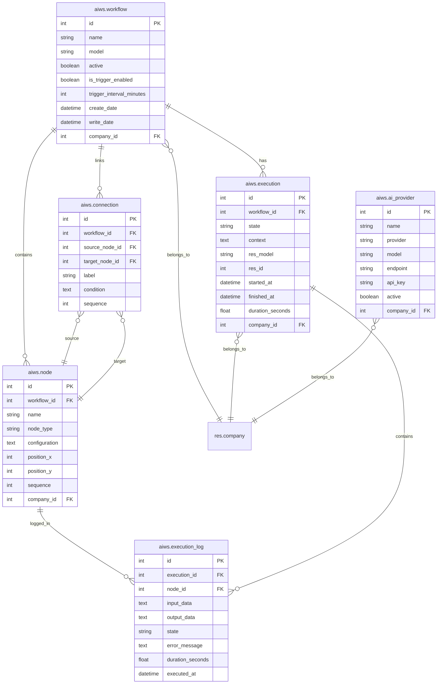

# 02. Arquitectura — ai_workflow_studio

**Módulo:** ai_workflow_studio  
**Versión:** 19.0.1.0.0  
**Estado:** Cerrado (revisado por Arquitecto y Seguridad — ver docs/reviews/fase2.md)

---

## 1. Prefijo y nomenclatura

Se ha verificado en el código fuente de Odoo 19 (`odoo/addons/`) que **no existe ningún módulo nativo `ai`**, por lo que no hay colisión de nombres de modelos. No obstante, por convención de seguridad y claridad, todos los modelos del módulo usan el prefijo **`aiws.`** (ai workflow studio).

Modelos mínimos de referencia (todos en `ai_workflow_studio/models/`):
- `aiws.workflow`
- `aiws.node`
- `aiws.connection`
- `aiws.execution`
- `aiws.execution_log`
- `aiws.ai_provider`

---

## 2. Persistencia del grafo: relacional (elegido)

**Decisión:** persistencia relacional con modelos `aiws.node` y `aiws.connection`, en lugar de un solo campo JSON en el workflow.

**Justificación:**
- Permite consultas SQL eficientes (nodos por workflow, conexiones entrantes/salientes, grafo para detección de ciclos).
- Soporta reglas de registro (multi-compañía) y ACL por entidad.
- Permite trazabilidad por nodo (`aiws.execution_log` apunta a `aiws.node`).
- Sincronización con el editor visual: el editor envía el grafo completo (nodos + conexiones) al guardar; el backend lo sincroniza borrando y recriando nodos/conexiones del workflow (estrategia simple y consistente, idempotente).

Cada nodo guarda `position_x`, `position_y` y `configuration` (JSONB-ish `fields.Text` con JSON) para portar la configuración específica del tipo de nodo y su posición visual.

---

## 3. Modelo de datos y relaciones

### aiws.workflow
Definición del flujo.
- `name`: Char, required, traducible
- `description`: Text
- `model`: Char (modelo objetivo Odoo, ej. `sale.order`), opcional
- `active`: Boolean, default True
- `is_trigger_enabled`: Boolean, default False (disparador programado)
- `trigger_interval_minutes`: Integer, default 60
- `company_id`: Many2one `res.company`, default compañía actual
- `node_ids`: One2many `aiws.node` (workflow_id)
- `connection_ids`: One2many `aiws.connection` (workflow_id)
- `start_node_id`: Many2one `aiws.node` (computed/存储, nodo tipo start)
- `create_date`, `write_date`, `create_uid`, `write_uid`

### aiws.node
Un nodo dentro de un workflow.
- `workflow_id`: Many2one `aiws.workflow`, required, ondelete=cascade
- `name`: Char, required
- `node_type`: Selection [start, end, condition, odoo_action, webhook, mail, python_script, ai_agent], required
- `configuration`: Text (JSON con configuración específica del tipo)
- `position_x`: Integer, default 0
- `position_y`: Integer, default 0
- `sequence`: Integer, default 10
- `company_id`: Many2one `res.company` (heredada del workflow vía related o store)

### aiws.connection
Conexión dirigida entre dos nodos.
- `workflow_id`: Many2one `aiws.workflow`, required, ondelete=cascade
- `source_node_id`: Many2one `aiws.node`, required
- `target_node_id`: Many2one `aiws.node`, required
- `label`: Char
- `condition`: Text (expresión de condición para nodos tipo condition)
- `sequence`: Integer, default 10

### aiws.execution
Instancia de ejecución.
- `workflow_id`: Many2one `aiws.workflow`, required
- `state`: Selection [running, done, error], default running
- `context`: Text (JSON contexto inicial de variables)
- `res_model`: Char (modelo del registro objetivo)
- `res_id`: Integer (ID del registro objetivo)
- `company_id`: Many2one `res.company`
- `started_at`: Datetime
- `finished_at`: Datetime
- `duration_seconds`: Float (computed)
- `log_ids`: One2many `aiws.execution_log` (execution_id)

### aiws.execution_log
Trazabilidad por nodo.
- `execution_id`: Many2one `aiws.execution`, required, ondelete=cascade
- `node_id`: Many2one `aiws.node`, required
- `node_type`: Char (related/almacenado)
- `input_data`: Text (JSON entrada al nodo)
- `output_data`: Text (JSON salida del nodo; claves sensibles excluidas)
- `state`: Selection [done, error]
- `error_message`: Text
- `duration_seconds`: Float
- `executed_at`: Datetime

### aiws.ai_provider
Credenciales de proveedores IA (solo administradores).
- `name`: Char, required
- `provider`: Selection [openai, gemini, claude, ollama, opencode, other], required
- `model`: Char (modelo por defecto)
- `endpoint`: Char
- `api_key`: Char (password, nunca en logs)
- `active`: Boolean, default True
- `company_id`: Many2one `res.company`

---

## 4. Motor de ejecución

**Patrón:** estrategia por tipo de nodo (registro extensible `aiws.node.handler` en memoria o métodos por tipo en `aiws.execution`).

Flujo de ejecución:
1. Validar grafo (un start, al menos un end, sin ciclos) — detectado con DFS antes de ejecutar.
2. Crear `aiws.execution` (state=running).
3. Desde el nodo start, seguir conexiones; para cada nodo:
   - Crear `aiws.execution_log` (state=running).
   - Ejecutar handler según `node_type` con el contexto de variables acumulado.
   - Guardar entrada/salida/estado/duración/error en el log.
   - Si error: marcar ejecución `error`, guardar error, detener (reintentos hasta 3).
4. Al llegar a un nodo end: marcar ejecución `done`, `finished_at`.
5. Límites: máximo 100 pasos por ejecución, timeout 300 s por ejecución, 30 s por paso.

Ejecución manual: síncrona en el hilo de la petición (controlador/botón).
Ejecución programada: `ir.cron` que llama a `aiws.workflow._trigger_flows` (modelo `ir.cron` nativo de Odoo 19, sin módulos externos).

Contexto de variables: dict pasado entre nodos; cada nodo puede leer/escribir claves. Evaluación segura de condiciones (sin `eval` crudo; se usa `safe_eval` de `odoo.tools` con contexto restringido).

---

## 5. Editor visual (Community)

**Decisión:** componente OWL puro (SVG/HTML), sin librerías externas. Vendored: nada.

Características:
- Lienzo SVG con nodos (rectángulos con puertos) y conexiones (líneas SVG con flecha).
- Arrastrar nodos (drag), crear conexión (clic puerto origen → clic puerto destino), eliminar.
- Zoom con rueda de ratón, pan al arrastrar fondo.
- Validación al guardar (start/end/ciclos) en el backend; errores mostrados en notificación Odoo.
- Guardado: POST del grafo completo al controlador `/aiws/workflow/<id>/save_graph`.

No se usa `web_editor` ni librerías de diagramado externas (evitar dependencias no justificadas y problemas de licencia en Community).

---

## 6. Trazabilidad y retención

- Cada ejecución genera `aiws.execution` + uno o varios `aiws.execution_log`.
- Limpieza configurable: `aiws.execution` y logs antiguos (parámetro del sistema `aiws.log_retention_days`, default 30), borrados por `ir.cron` semanal.
- Los logs excluyen `api_key` y credenciales.

---

## 7. Seguridad (resumen; detalle en Fase 3)

- Grupos: `aiws_group_user` (ver/ejecutar), `aiws_group_editor` (crear/editar), `aiws_group_admin` (credenciales, scripts, configuración).
- ACL en `security/ir.model.access.csv`.
- Reglas de registro multi-compañía en `security/aiws_rule_*.xml` con `company_id`.
- Nodo Script Python: solo admin; `safe_eval` sin `os`/`sys`/red/archivos (ver DECISIONES.md — candidato a V2).
- Nodo Webhook: bloqueo de IPs internas/loopback, timeout 10 s, respuesta max 1 MB.
- Nodo Acción Odoo: usuario actual, sin `sudo()` implícito.
- Credenciales: campo `password`, excluidas de logs, invisibles para no-admin.

---

## 8. Diagrama ER (Mermaid)

---

## 9. Decisiones obligatorias resueltas (Fase 2)

| Decisión | Opción elegida | Justificación |
|----------|----------------|---------------|
| Persistencia del grafo | Relacional (nodos + conexiones) | Consultas SQL, ACL, trazabilidad, reglas de registro |
| Editor visual | OWL puro SVG/HTML, sin libs externas | Comunidad, sin dependencias, licencia compatible |
| Motor de ejecución | Estrategia por tipo de nodo, contexto de variables, `ir.cron` | Extensible, sin módulos externos |
| Prefijo de modelos | `aiws.` | No colisión con módulo `ai` (inexistente en Odoo 19) |
| Nodo Script Python | Diferido a V2 o sandbox `safe_eval` estricto | Seguridad no negociable |
| Capa IA | Interfaz abstracta proveedor/modelo/request/response, stub en V1 | Desacoplamiento |

**Fase 2 cerrada.**
